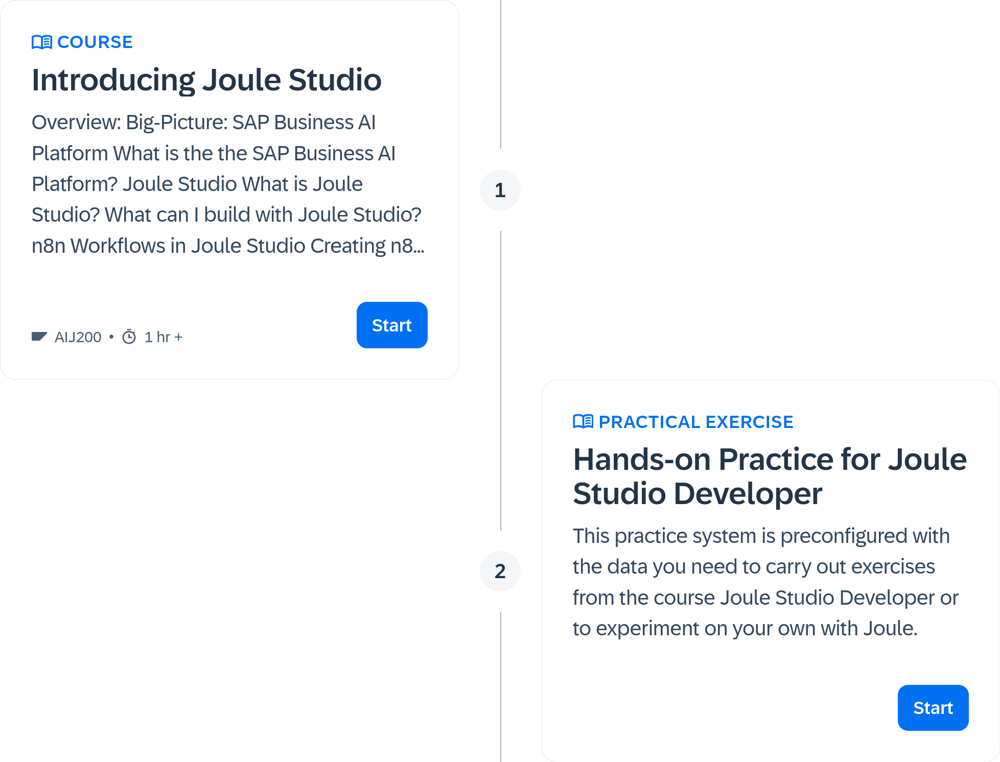
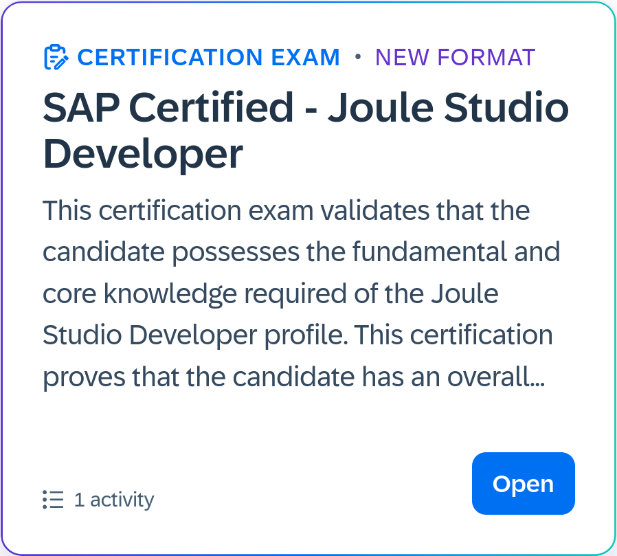

+++
date = '2026-11-06T00:10:00+01:00'
draft = false
description = 'SAP has launched a new practical certification for building AI agents with Joule Studio — and one exam attempt is free until December 31, 2026. Here is what it covers and how to claim your voucher.'
title = 'Joule Studio Developer Certification: Intent is all you need'
tags = ['SAP', 'Joule Studio', 'Certification', 'AI']
comments = false
TocOpen = true

[cover]
  image = "cover.png"
  alt = "Joule Studio Developer Certification"

[ai]
  level = 'assisted' #assisted or generated
  note = 'Optimized the Post, and its formatting'
  model = 'GLM 5.3 via Mistral AI'
  hiddenInList = true
+++

SAP has been betting big on AI for a few years now, and all their announcements speak loudly about their intention to integrate AI into their products. Earlier this year, SAP launched Joule Studio for enabling Enterprise-grade Agent solutions. Now SAP is putting a certification on top of it — and for a limited window, the first attempt is free.

## What is this certification about?

The **Joule Studio Developer Certification** is a new certification for technical professionals to get hands-on experience building and extending **AI agents, applications, and workflows** with Joule Studio.

What it validates, in practice, is the full journey from idea to running solution:

- **Intent-based development** — translating a business idea into a deployable agent using Joule Studio's natural-language-driven development experience.
- **Building and extending AI agents** — creating custom agents, or extending Lines of Business (LoB) agents to address specific business needs.
- **Business context** — grounding agents in relevant SAP business data and context, i.e., Retrieval Augmented Generation (RAG) in SAP's language.
- **Deployment and lifecycle management** — testing, managing, and deploying agents and skills throughout their lifecycle, with governance and security built in.

Why the practical angle matters: As SAP pushes its AI-first development strategy, this certification will help with two things:
- You get to try out Joule Studio without any manual setups.
- The certification adds another skill to your portfolio.

## Steps to enroll for the certification

SAP is offering **one certification attempt at no cost** to give developers and technical professionals across the ecosystem a chance to build and validate these skills.

> [!IMPORTANT]
> 1. The free voucher is valid until **December 31, 2026**. If you are reading this after that date, the window has closed.
> 2. Ensure that your SAP Universal ID has two **different email addresses** assigned. It's a prerequisite set by SAP.

To claim it:

1. Head to this [SAP Learning certification page](https://learning.sap.com/joule-studio-certification) and click on "Claim Voucher". You will have to log in to your SAP Universal account, if not already logged in.

2. The first section provides an introductory course, and the second section provides the practice system.

> [!WARNING]
> You have 24 hours to practice and to attempt the free certification. The moment you start the practice session, the 24-hour timer starts.

3. Once satisfied, schedule and take your exam before December 31, 2026.

## Wrapping up: Buckle up and get certified

For those of us in the SAP ecosystem — especially ABAP developers watching AI reshape the tools we use daily — this is a great way to add an AI certification to your profile at zero cost. Worst case, you learn how agents are actually built on the SAP Business AI Platform. Best case, you walk out certified.

If you plan to take it, start preparing now: the free attempt does not wait past December 31, 2026.

## References
1. [SAP Community: Introducing Joule Studio Certification](https://community.sap.com/t5/sap-learning-blog-posts/introducing-joule-studio-certification-build-real-world-ai-skills-practice/ba-p/14511559)
2. [SAP Learning: Free Joule Studio Certification FAQs](https://learning.sap.com/helpcenter/certification-support/free-joule-studio)
